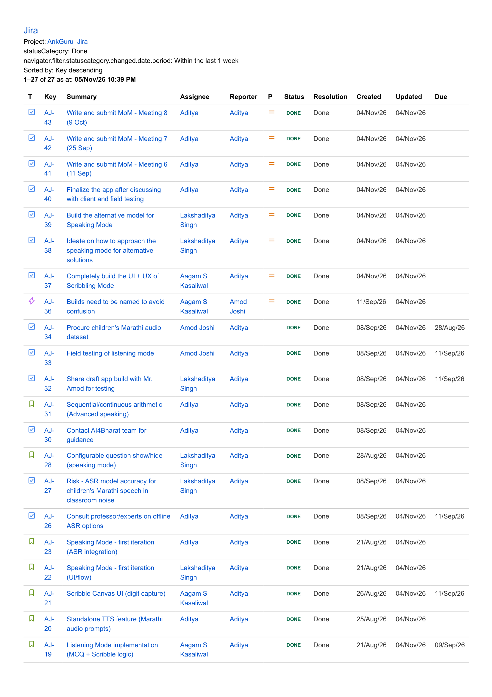

# AnkGuru (अंकगुरू)
### Offline AI-Powered Foundational Numeracy & Mental Math Learning App

---

> ### 🌐 [👉 View Project Introduction Webpage (Live Landing Page)](https://ead-labs.github.io/Group-5_2026/)
> * **Alternative Instant Web Preview:** [Open via HTMLPreview](https://htmlpreview.github.io/?https://github.com/EAD-Labs/Group-5_2026/blob/main/index.html) *(Works immediately without waiting for GitHub Pages build)*
> * **Repository Source:** View [`index.html`](./index.html) directly in this repo.

---

[](https://www.iitb.ac.in)
[](https://www.iitb.ac.in)
[](#client-organization--operational-domain)
[](https://creativecommons.org/licenses/by/4.0/)
[](#key-architectural-highlights)
[](https://github.com/EAD-Labs/Group-5_2026/releases/download/v3.1/AnkGuru-v3.1-Final.apk)

---

## 📑 Quick Navigation & Core Deliverables

| Deliverable | Description | Direct Access Link |
| :--- | :--- | :--- |
| 🌐 **Project Introduction Page** | Interactive landing page for non-technical audiences | [Live GitHub Pages](https://ead-labs.github.io/Group-5_2026/) • [Instant Web Preview](https://htmlpreview.github.io/?https://github.com/EAD-Labs/Group-5_2026/blob/main/index.html) • [`index.html`](./index.html) |
| 📱 **Production APK (v3.1)** | Ready-to-install Android APK (tested Android 8–15) | [Direct Download (55.45 MB)](https://github.com/EAD-Labs/Group-5_2026/releases/download/v3.1/AnkGuru-v3.1-Final.apk) • [GDrive Mirror](https://tinyurl.com/ankguru-app) |
| 🎥 **Client Feedback Video** | 2–3 min video featuring Mr. Amod Joshi (N+1 NGO) | [Watch on Google Drive](https://drive.google.com/file/d/1ar5OOENPHX6zPU_vvquvzu9AqVEOTYfv/view?usp=sharing) |
| 📄 **Field Study Report** | Strict 5-Page Field Study & System Design Report (PDF) | [View Report PDF](./FIELD_STUDY_REPORT.pdf) • [LaTeX Source](./FIELD_STUDY_REPORT.tex) |
| 🖼️ **Exhibition Poster** | Final high-resolution conference & evaluation poster | [View Poster Image](./assets/poster.png) • [Poster Notes](./POSTER_CONTENT.md) |
| 📋 **Project Tracking (Jira)** | Sprint tracking screenshots & complete task logs | [Jira Evidence Section](#project-management--jira-tracking-evidence) • [Download PDF](./Jira-tasks.pdf) |

---

## 1. Project Overview & Educational Problem

**AnkGuru (अंकगुरू)** is a privacy-first, zero-cost, **100% offline mobile educational application** engineered to build foundational Devanagari numeracy and mental arithmetic fluency among primary school children (Grades 3 to 6). 

The system was developed under **ET 617: Educational Application Development** at **IIT Bombay** in close collaboration with **N+1 NGO** for deployment in government Zilla Parishad and residential Ashram schools across rural Palghar District, Maharashtra.

### The Educational Problem
In rural Maharashtra, many first-generation tribal learners (predominantly Katkari and Warli communities) experience severe foundational numeracy deficits:
1. **Auditory-to-Symbolic Disconnect:** Children can recite Marathi counting chants orally, but struggle to map spoken number words (*"सत्तावीस"* — 27) to their written Devanagari numerals (२७) and quantities.
2. **First-Generation Learning Barrier:** With illiterate or daily-wage earning parents, children have no learning reinforcement or guided practice outside school hours.
3. **Severe Connectivity Constraints:** Remote tribal Ashram schools lack reliable cellular data and Wi-Fi. Mainstream educational apps fail because they require cloud logins, high-bandwidth streaming, or recurring subscriptions.
4. **Language & Dialect Gap:** Commercial apps focus predominantly on English or standard Hindi, leaving Marathi-first rural students alienated.

**AnkGuru solves this by executing state-of-the-art neural recognition and speech synthesis entirely on-device, requiring no internet connection, no user accounts, and zero recurring operational expenses.**

---

## 2. Client Organization & Operational Domain

* **Partner Organization:** **N+1 NGO** (*"One Story. One Idea. One Action"*)
* **Client Representative:** **Mr. Amod Joshi** (Founder & Operations Coordinator)
* **Target Environment:** Palghar District, Maharashtra (Zilla Parishad & Ashram residential schools)
* **Target Learners:** 180+ enrolled primary students in Grades 3 to 6 (Ages 8–12)

---

## 3. Three Interactive Learning Modes

AnkGuru reinforces numeracy through three scaffolded, multi-sensory pedagogical modes:

```
                  ┌───────────────────────────────────────────────┐
                  │               AnkGuru Home Menu               │
                  └──────┬────────────────┬───────────────┬───────┘
                         │                │               │
                         ▼                ▼               ▼
          ┌──────────────────────┐ ┌───────────────┐ ┌──────────────────────┐
          │ 1. Listen & Choose   │ │2. Listen &    │ │ 3. Speak & Verify    │
          │    (ऐका आणि निवडा)   │ │   Draw/Slate  │ │    (बोला आणि तपासा)  │
          │                      │ │ (ऐका आणि लिहा)│ │                      │
          │  • Marathi TTS audio │ │ • Audio prompt│ │ • Visual problem card│
          │  • 4 Devanagari cards│ │ • Dual-slate  │ │ • Child speaks orally│
          │  • Instant chime     │ │   (Tens/Units)│ │ • Audio confirmation │
          │    feedback          │ │ • 156k CNN    │ │ • Teacher check      │
          └──────────────────────┘ └───────────────┘ └──────────────────────┘
```

### 🔊 Mode 1: Listen & Choose (ऐका आणि निवडा)
* **Mechanism:** The app vocalizes an arithmetic question or number in natural Marathi (e.g., *"सत्तावीस अधिक तीन किती?"* — What is 27 + 3?).
* **Interaction:** The child listens and taps the matching Devanagari number card among 4 randomized options.
* **Feedback:** Instant visual highlight and cheerful auditory chime reinforce correct selections without penalty.

### ✍️ Mode 2: Listen & Draw / Scribble (ऐका आणि लिहा)
* **Mechanism:** The student listens to a spoken number or math problem, then writes the digits using their finger on dual responsive chalkboard slates (Tens slate on left, Units slate on right).
* **AI Recognition:** Evaluated in real time by an embedded **156,000-parameter Devanagari Convolutional Neural Network (CNN)** running entirely in JavaScript.
* **Child-Tolerant Heuristic:** Includes an integral bounding-box normalization engine and a **$\ge 20\%$ runner-up threshold**, preventing false negatives caused by shaky child motor control or regional stroke variations (e.g., looping variations in Devanagari ४, ८, and ९).
* **Zero Screen Drift:** Custom locked container layout with `touch-action: none` ensures that writing on compact or budget smartphones (e.g., Realme, Redmi) never scrolls or jitters the display.

### 🗣️ Mode 3: Speak & Verify (बोला आणि तपासा)
* **Mechanism:** Presents visual arithmetic problems (e.g., $15 + 12 = ?$).
* **Oral Fluency:** The child computes the answer mentally and vocalizes it aloud in Marathi (*"सत्तावीस"*).
* **Verification:** The child or facilitator taps *"Play Audio"* to hear the authoritative Marathi pronunciation, confirming correctness and reinforcing phonetic accuracy without requiring unreliable offline speech recognition models.

---

## 4. Target User Personas

| Dimension | Primary Persona: **Meera** (Student) | Secondary Persona: **Suresh Kamble** (Facilitator) |
| :--- | :--- | :--- |
| **Role & Age** | Grade 4 Primary Student (Age 9.5), Warli Tribal Community | Community Teacher / NGO Remedial Coordinator |
| **Environment** | Shared classroom or home phone; zero internet; loud ambient noise | Multi-grade classroom of 35–40 students simultaneously |
| **Literacy & Tech** | Marathi-first; low text literacy; new to touchscreen devices | Basic Android literacy; non-technical; no coding background |
| **Core Needs** | High-contrast visual cues, voice-prompted instructions, low stress | Zero configuration, no login/password management, 100% offline |
| **App Feature** | Dual chalkboard slates, large touch targets, encouraging audio chimes | Rapid group facilitation, instant oral self-check mode |

---

## 5. Key Architectural Highlights & Engineering Innovations

1. **100% Offline by Design:**
   * Zero cloud dependencies, zero external network calls, zero telemetry, and zero user accounts.
   * Completely eliminates recurrent server maintenance and cloud API billing.
2. **Embedded 156k-Parameter Devanagari CNN:**
   * Lightweight model (~600 KB weights) trained on Devanagari digits (०–९) with 2D bounding-box spatial centering and aspect-ratio normalization.
   * Delivers sub-15ms inference latency directly inside the mobile runtime.
3. **Robust 3-Tier Marathi Speech Synthesis:**
   * Overcomes Android 14+ package visibility restrictions using declared `TTS_SERVICE` intent queries.
   * Cascades gracefully: Native Marathi (`mr-IN`) $\rightarrow$ Hindi Phonetic Fallback (`hi-IN`) $\rightarrow$ Pre-rendered audio buffer.
4. **Adaptive Slate Geometry for Compact Budget Devices:**
   * Uses viewport-aware height clamping (`clamp(140px, calc(100vh - 105px), 220px)`) and strict gesture trapping (`touch-action: none !important`).
   * Eliminates unwanted screen scrolling while drawing, tested on 5.5" to 6.7" displays.
5. **Ultra-Lightweight Footprint:**
   * Total standalone APK size is **55.45 MB** (reduced by 72% from the initial 198 MB Whisper experiment), ensuring effortless peer-to-peer Bluetooth / Nearby Share distribution between teachers' phones.

---

## 6. Project Management & Jira Tracking Evidence

All engineering milestones, sprint backlogs, bug fixes, and client acceptance criteria were tracked using **Atlassian Jira** (`ANK` project). 

### Sprint Summary & Milestones
* **Total Tasks Tracked & Resolved:** 27 Tasks (`AJ-1` to `AJ-43`)
* **Sprint Velocity & Completion:** 100% of planned user stories and spikes achieved `DONE` status.
* **Core Sprints Covered:**
  * **Sprint 1 (Foundations):** Client requirement elicitation with Mr. Amod Joshi, Palghar field study, HLD preparation, and baseline offline React Native Bare Workflow setup.
  * **Sprint 2 (Core AI & Multi-Modal Engines):** 156k CNN integration, dual-slate canvas architecture, Devanagari stroke normalization, and offline Marathi TTS cascading.
  * **Sprint 3 (Pilot Testing & Refinement):** Pilot deployment with Palghar learners, digit 8/9 recognition tuning ($\ge 20\%$ runner-up threshold), Realme screen-scroll bug fix, and production APK signing.

### Jira Board Screenshots

#### Sprint Board Page 1: Tasks AJ-20 through AJ-43 (Core Engineering & Pilot Iterations)


#### Sprint Board Page 2: Tasks AJ-1 through AJ-19 (Foundational Architecture & Requirements)


> 📥 **Complete Audit Trail:** Download the full exported Jira project PDF report: [`Jira-tasks.pdf`](./Jira-tasks.pdf).

---

## 7. How to Access, Install, and Run AnkGuru

### Option A: Install on an Android Smartphone (Recommended for Evaluators)
No developer tools or setup required. Install directly on any Android smartphone running Android 8.0 (Oreo) up to Android 15:
1. **Download the APK:** Download [`AnkGuru-v3.1-Final.apk`](https://github.com/EAD-Labs/Group-5_2026/releases/download/v3.1/AnkGuru-v3.1-Final.apk) directly or use the [Google Drive Mirror](https://tinyurl.com/ankguru-app).
2. **Allow Installation:** Tap the downloaded file. When prompted by Android, select **Settings** and enable **"Allow from this source"**.
3. **Launch:** Tap **Install**, then open **AnkGuru**. The app works immediately without requiring internet or account login.

### Option B: Build and Run from Source Code (Developers)

#### Prerequisites
* Node.js (v18.x or v20.x recommended)
* npm (v9.x or later)
* Java Development Kit (JDK 17)
* Android Studio with Android SDK (API Level 34) & Build Tools

#### Step-by-Step Instructions

1. **Clone the Repository:**
   ```bash
   git clone https://github.com/EAD-Labs/Group-5_2026.git
   cd Group-5_2026
   ```

2. **Install Root and Workspace Dependencies:**
   ```bash
   npm install
   cd artifacts/ankguru
   npm install
   ```

3. **Start the Development Metro Server:**
   ```bash
   npx expo start
   ```

4. **Launch on an Android Device or Emulator:**
   ```bash
   # Connect your Android phone with USB Debugging enabled
   npx expo run:android
   ```

5. **Build the Standalone Production Release APK:**
   ```bash
   cd android
   ./gradlew assembleRelease
   # Output APK will be generated at:
   # android/app/build/outputs/apk/release/app-release.apk
   ```

---

## 8. Repository Structure

```text
Group-5_2026/
├── index.html                     # Project Introduction Landing Page (Non-Technical Audience)
├── README.md                      # Primary Project Documentation & Evaluation Overview
├── FIELD_STUDY_REPORT.pdf         # Strict 5-Page Field Study & System Design Report (PDF)
├── FIELD_STUDY_REPORT.tex         # LaTeX Source Code for the 5-Page Report
├── Jira-tasks.pdf                 # Complete Jira Tasks & Sprint Execution Export (PDF)
├── HLD-V3.docx                    # High-Level Design Document V3 (Client Approved)
├── POSTER_CONTENT.md              # Exhibition Poster Transcript & Content Guide
├── assets/
│   ├── icon.png                   # Official AnkGuru Application Icon
│   ├── poster.png                 # High-Resolution Final Presentation Poster
│   └── tracking/
│       ├── jira_tasks_page_1.png  # Jira Sprint Board Evidence (Page 1)
│       └── jira_tasks_page_2.png  # Jira Sprint Board Evidence (Page 2)
├── artifacts/
│   └── ankguru/                   # Core Mobile Application Codebase (React Native Bare Workflow)
│       ├── app/
│       │   ├── _layout.tsx        # Navigation stack & global error boundaries
│       │   ├── index.tsx          # Splash & mode selection landing screen
│       │   └── home.tsx           # Practice UI, dual-slate canvas & audio controllers
│       ├── components/            # Touch-optimized buttons, slates & feedback cards
│       ├── constants/             # Color tokens, typography & Devanagari numerals
│       └── utils/
│           ├── ankguruHtml.js     # Webview-bridged high-speed canvas engine
│           ├── mnist_weights.js   # 156,000-parameter Devanagari CNN weights
│           └── scribbleEngineHtml.js # Responsive touch slate with zero-scroll lock
└── android/                       # Native Android Project Files & Gradle Build Scripts
```

---

## 9. Project Team & Acknowledgments

### ET 617 — Group 5 (IIT Bombay)

* **Lakshaditya Singh** (`23B2230`) — *Lead System Architect & Mobile Engineer*  
  Architecture design, React Native bare workflow engine, offline Marathi TTS integration, compact device viewport responsiveness, APK release pipeline.
* **Aagam S. Kasaliwal** (`23B2215`) — *Machine Learning & Audio Engineer*  
  Devanagari CNN model optimization, stroke bounding-box normalization, dataset curation, ASR feasibility study.
* **Aditya Anand Gupta** (`23B2144`) — *UI/UX Designer & Field Study QA Lead*  
  Field study methodology, NGO liaison, persona journey mapping, usability testing with Palghar tribal students.

### Special Thanks
We extend our deepest gratitude to **Mr. Amod Joshi** and the entire field team at **N+1 NGO** for their invaluable domain insights, facilitating classroom visits in Palghar, and collaborating closely with our team to bring AnkGuru to life.

---

## 10. License

This project, its code, documentation, and neural network weights are released under the **[Creative Commons Attribution 4.0 International License (CC BY 4.0)](https://creativecommons.org/licenses/by/4.0/)**.

You are free to share, copy, adapt, and build upon this work with appropriate attribution to the authors and IIT Bombay.
